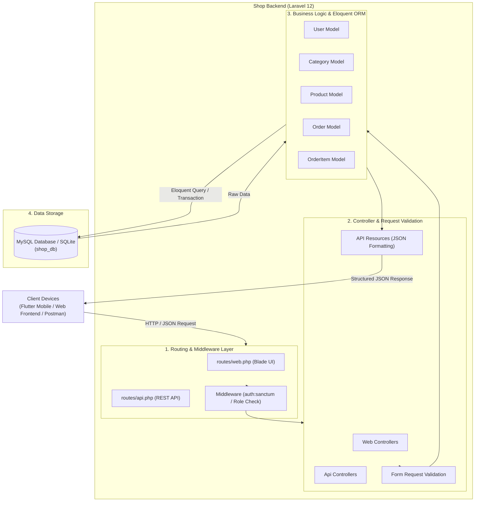
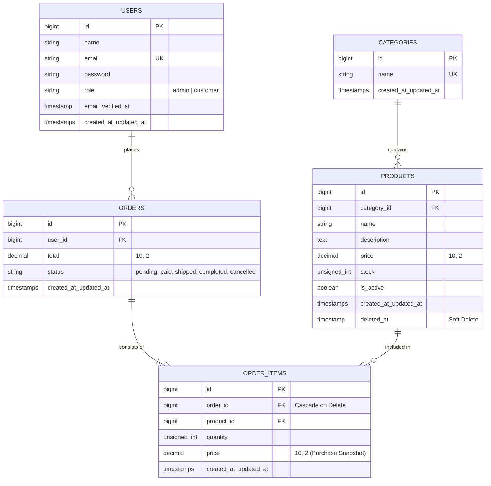

# 📘 คู่มือสถาปัตยกรรมและโครงสร้างโปรเจกต์ (Project Architecture & Developer Manual)
**ระบบ Backend ร้านค้าออนไลน์ (Shop Backend E-Commerce API)**

---

## 1. ข้อมูลภาพรวมของโปรเจกต์ (Project Overview)

โปรเจกต์ **Shop Backend** เป็นระบบบริหารจัดการข้อมูลหลังบ้านและ API สำหรับร้านค้าออนไลน์ (E-Commerce) พัฒนาบนพื้นฐานของ **Laravel 12** โดยมีเป้าหมายหลักในการทำหน้าที่เป็น Service และ RESTful API ให้กับเว็บแอปพลิเคชัน และ โมบายล์แอปพลิเคชัน (เช่น Flutter)

### วัตถุประสงค์หลัก
1. **การจัดการสินค้าและหมวดหมู่ (Product & Category Management):** รองรับการเพิ่ม ลบ แก้ไข ค้นหา และแบ่งหน้าสินค้า พร้อมระบบ Soft Delete
2. **การจัดการคำสั่งซื้อ (Order & Order Items):** รองรับการทำธุรกรรมสั่งซื้อสินค้า การบันทึกราคาสินค้า ณ เวลาสั่งซื้อ (Price Snapshot)
3. **ระบบผู้ใช้งานและการยืนยันตัวตน (User & Authentication):** รองรับการแบ่งบทบาทผู้ใช้ (`admin`, `customer`) และการตรวจสอบสิทธิ์
4. **API Provider:** เป็นศูนย์กลางข้อมูลที่ส่งออกในรูปแบบ JSON มาตรฐานเพื่อรองรับ Frontend หลากหลายแพลตฟอร์ม

---

## 2. ข้อมูลทางเทคนิคและสแต็กเทคโนโลยี (Tech Stack)

| ส่วนประกอบ (Component) | เทคโนโลยี / เวอร์ชัน | หน้าที่ / รายละเอียด |
| :--- | :--- | :--- |
| **Framework** | Laravel 12.x (12.71.0) | แกนหลักของระบบ Backend MVC / REST API |
| **Language** | PHP 8.2+ | ภาษาหลักในการพัฒนาฝั่งเซิร์ฟเวอร์ |
| **Database** | MySQL (XAMPP) / SQLite | ระบบฐานข้อมูลเชิงสัมพันธ์ (Relational DB) |
| **ORM** | Eloquent ORM | ตัวจัดการ Object-Relational Mapping |
| **Front-end Tooling** | Vite 7.x, Tailwind CSS v4 | เครื่องมือคอมไพล์ CSS/Asset สำหรับหน้า Blade |
| **Development Utilities** | Tinker, Faker, Concurrently | เครื่องมือช่วยทดสอบและจำลองข้อมูล (Seeding) |

---

## 3. สถาปัตยกรรมระบบ (System Architecture)

ระบบถูกออกแบบตามสถาปัตยกรรม **MVC (Model-View-Controller)** ร่วมกับรูปแบบ **RESTful API Architecture**:



---

## 4. โครงสร้างฐานข้อมูลและความสัมพันธ์ (Database & ER Diagram)

### 4.1 แผนภาพความสัมพันธ์ของเอนทิตี (Entity-Relationship Diagram)



### 4.2 รายละเอียดตารางและโมเดล (Data Dictionary & Model Details)

#### 1. ตาราง `users` (Model: `App\Models\User`)
* จัดเก็บข้อมูลผู้ใช้งานและผู้ดูแลระบบ
* **ฟิลด์สำคัญ:** `id`, `name`, `email` (Unique), `password` (Hashed), `role` (ค่าเริ่มต้น: `'customer'`)
* **ความสัมพันธ์:** 
  * `orders()` -> `hasMany(Order::class)`

#### 2. ตาราง `categories` (Model: `App\Models\Category`)
* จัดเก็บหมวดหมู่สินค้า
* **ฟิลด์สำคัญ:** `id`, `name` (Unique)
* **ความสัมพันธ์:** 
  * `products()` -> `hasMany(Product::class)`

#### 3. ตาราง `products` (Model: `App\Models\Product`)
* จัดเก็บรายการสินค้า รายละเอียด สต็อก และสถานะการวางจำหน่าย
* **ฟิลด์สำคัญ:** 
  * `category_id` (Foreign Key เชื่อมกับ `categories.id`)
  * `name`, `description`, `price` (Decimal 10,2)
  * `stock` (จำนวนคงเหลือในคลัง), `is_active` (เปิด/ปิดการมองเห็น)
  * `deleted_at` รองรับระบบ **SoftDeletes** (ลบโดยยังคงข้อมูลไว้ในฐานข้อมูล)
* **Casts:** `'price' => 'decimal:2'`, `'stock' => 'integer'`, `'is_active' => 'boolean'`
* **ความสัมพันธ์:** 
  * `category()` -> `belongsTo(Category::class)`
  * `orderItems()` -> `hasMany(OrderItem::class)`

#### 4. ตาราง `orders` (Model: `App\Models\Order`)
* จัดเก็บส่วนหัวของคำสั่งซื้อและยอดรวม
* **ฟิลด์สำคัญ:** 
  * `user_id` (Foreign Key เชื่อมกับ `users.id`)
  * `total` (ยอดรวมคำสั่งซื้อ Decimal 10,2)
  * `status` (สถานะคำสั่งซื้อ เช่น `pending`, `paid`, `shipped`, `completed`, `cancelled`)
* **Casts:** `'total' => 'decimal:2'`
* **ความสัมพันธ์:** 
  * `user()` -> `belongsTo(User::class)`
  * `orderItems()` -> `hasMany(OrderItem::class)`

#### 5. ตาราง `order_items` (Model: `App\Models\OrderItem`)
* จัดเก็บรายการสินค้าภายในแต่ละคำสั่งซื้อ
* **ฟิลด์สำคัญ:** 
  * `order_id` (Foreign Key เชื่อมกับ `orders.id` พร้อม `cascadeOnDelete`)
  * `product_id` (Foreign Key เชื่อมกับ `products.id`)
  * `quantity` (จำนวนที่สั่งซื้อ)
  * `price` (ราคาต่อหน่วย **ณ ขณะที่ทำการสั่งซื้อ** ป้องกันผลกระทบเมื่อราคาสินค้าในตาราง products มีการเปลี่ยนแปลงภายหลัง)
* **Casts:** `'price' => 'decimal:2'`, `'quantity' => 'integer'`
* **ความสัมพันธ์:** 
  * `order()` -> `belongsTo(Order::class)`
  * `product()` -> `belongsTo(Product::class)`

---

## 5. โครงสร้างโฟลเดอร์ของโปรเจกต์ (Directory Structure)

```text
shop_backend/
├── app/
│   ├── Http/
│   │   └── Controllers/
│   │       ├── Controller.php          # Base Controller
│   │       └── Api/                    # แนะนำสำหรับแยก API Controllers
│   ├── Models/
│   │   ├── Category.php                # Category Model
│   │   ├── Order.php                   # Order Model
│   │   ├── OrderItem.php               # OrderItem Model
│   │   ├── Product.php                 # Product Model (SoftDeletes)
│   │   └── User.php                    # User Model (Authenticatable)
│   └── Providers/
│       └── AppServiceProvider.php      # Global Application Service Provider
├── bootstrap/
│   └── app.php                         # กำหนด Route, Middleware, Exception ของ Laravel 12
├── config/                             # ไฟล์คอนฟิก (database, auth, cache, mail ฯลฯ)
├── database/
│   ├── factories/                      # Model Factories สำหรับ Mock Data
│   │   ├── CategoryFactory.php
│   │   ├── OrderFactory.php
│   │   ├── OrderItemFactory.php
│   │   ├── ProductFactory.php
│   │   └── UserFactory.php
│   ├── migrations/                     # การสร้าง Schema ฐานข้อมูล
│   │   ├── 0001_01_01_000000_create_users_table.php
│   │   ├── 2026_11_09_152019_add_role_to_users_table.php
│   │   ├── 2026_11_09_152019_create_categories_table.php
│   │   ├── 2026_11_09_152020_create_products_table.php
│   │   ├── 2026_11_09_152020_create_orders_table.php
│   │   └── 2026_11_09_152027_create_order_items_table.php
│   └── seeders/
│       ├── DatabaseSeeder.php          # Seeder หลัก
│       └── ShopSeeder.php              # สุ่มสร้างสินค้า 30 รายการ, หมวดหมู่ และ User ทดสอบ
├── routes/
│   ├── console.php                     # Artisan Console Commands
│   └── web.php                         # Web Routes
├── knowledge.md                        # บันทึกสาระสำคัญและแผนงานการเรียนรู้/พัฒนา
└── PROJECT_MANUAL.md                   # คู่มือสถาปัตยกรรมและโครงสร้างโปรเจกต์ (เอกสารนี้)
```

---

## 6. ข้อมูลเริ่มต้นและข้อมูลจำลองในระบบ (Initial Seed Data)

เมื่อรัน Seeder (`ShopSeeder`) ระบบจะเตรียมข้อมูลสำหรับทดสอบไว้ดังนี้:

| ประเภท | อีเมล / ข้อมูล | รหัสผ่านเริ่มต้น | สิทธิ์ (Role) / รายละเอียด |
| :--- | :--- | :--- | :--- |
| **ผู้ดูแลระบบ (Admin)** | `admin@shop.test` | `password123` | `admin` |
| **ลูกค้าทดสอบ (Customer)** | `customer@shop.test` | `password123` | `customer` |
| **หมวดหมู่สินค้า (Categories)** | 1. Electronics<br>2. Clothing<br>3. Accessories | - | หมวดหมู่หลักเริ่มต้น 3 รายการ |
| **สินค้าจำลอง (Products)** | สุ่ม 30 รายการ (หมวดหมู่ละ 10 ชิ้น) | - | สุ่มชื่อ, ราคา, สต็อก และสถานะด้วย ProductFactory |

---

## 7. คู่มือการติดตั้งและเริ่มใช้งาน (Getting Started Guide)

### 7.1 ความต้องการของระบบ (Prerequisites)
1. **PHP:** เวอร์ชัน `>= 8.2` (พร้อม Extensions: `pdo`, `pdo_mysql`, `mbstring`, `openssl`)
2. **Composer:** เวอร์ชันล่าสุด
3. **Database Server:** MySQL บน XAMPP หรือ SQLite
4. **Node.js & NPM:** สำหรับการ build frontend asset

### 7.2 ขั้นตอนการติดตั้งแบบ Step-by-Step

#### 1. ติดตั้ง PHP Dependencies
```bash
composer install
```

#### 2. ตั้งค่าไฟล์สภาพแวดล้อม (.env)
คัดลอกไฟล์ `.env.example` เป็น `.env` (หากยังไม่มี) และสร้าง Application Key:
```bash
cp .env.example .env
php artisan key:generate
```

#### 3. การตั้งค่าฐานข้อมูล
เปิดไฟล์ `.env` แล้วกำหนดค่าการเชื่อมต่อ:

* **กรณีใช้งาน MySQL (ผ่าน XAMPP):**
  *(ตรวจสอบว่าเปิด Service Apache และ MySQL ใน XAMPP Control Panel แล้ว และสร้างฐานข้อมูลชื่อ `shop_db`)*
  ```env
  DB_CONNECTION=mysql
  DB_HOST=127.0.0.1
  DB_PORT=3306
  DB_DATABASE=shop_db
  DB_USERNAME=root
  DB_PASSWORD=
  ```

* **กรณีใช้งาน SQLite (สะดวกสำหรับการทดสอบแบบไม่พึ่ง XAMPP MySQL):**
  ```env
  DB_CONNECTION=sqlite
  ```

#### 4. รัน Database Migration และ Seeder
สั่งรัน Migration พร้อมเติมข้อมูลตั้งต้นลงฐานข้อมูล:
```bash
php artisan migrate --seed
```
*(หรือหากต้องการเคลียร์ตารางเก่าทั้งหมดแล้วสร้างใหม่: `php artisan migrate:fresh --seed`)*

#### 5. สตาร์ต Development Server
```bash
php artisan serve
```
เซิร์ฟเวอร์จะพร้อมทำงานที่ URL: `http://127.0.0.1:8000`

---

## 8. แนวทางการพัฒนาในลำดับถัดไป (Next Development Steps)

อ้างอิงจากแผนการพัฒนาระบบ REST API สำหรับเชื่อมต่อกับ Frontend/Flutter:

### 8.1 การติดตั้งและเปิดใช้งาน Laravel Sanctum API
ใน Laravel 12 สามารถเปิดใช้งานระบบ API และ Sanctum ได้อย่างรวดเร็วผ่านคำสั่ง:
```bash
php artisan install:api
```
คำสั่งนี้จะสร้างไฟล์ `routes/api.php` และคอนฟิก Sanctum Token Authentication ให้อัตโนมัติใน `bootstrap/app.php`

### 8.2 การออกแบบ REST API Endpoints แนะนำ

```text
POST   /api/login                  # ยืนยันตัวตนและรับ Bearer Token
POST   /api/register               # ลงทะเบียนผู้ใช้ใหม่
POST   /api/logout                 # เพิกถอน Token (ต้องมี auth:sanctum)
GET    /api/profile                # ดึงข้อมูลส่วนตัวของผู้ใช้ปัจจุบัน

GET    /api/categories             # แสดงรายการหมวดหมู่ทั้งหมด
GET    /api/products               # แสดงรายการสินค้า (รองรับ ?page= & category_id=)
GET    /api/products/{id}          # ดูรายละเอียดสินค้า
POST   /api/products               # เพิ่มสินค้าใหม่ (Admin Only)
PUT    /api/products/{id}          # แก้ไขสินค้า (Admin Only)
DELETE /api/products/{id}          # ลบสินค้า Soft Delete (Admin Only)

GET    /api/orders                 # รายการคำสั่งซื้อของผู้ใช้
POST   /api/orders                 # สั่งซื้อสินค้า (สร้าง Order และ OrderItems พร้อมคำนวณยอด)
GET    /api/orders/{id}            # ดูรายละเอียดคำสั่งซื้อ
```

### 8.3 ข้อแนะนำในการเขียนโค้ด (Best Practices)
1. **Form Requests:** ใช้ `php artisan make:request` สำหรับ Validate ข้อมูลเสมอ แทนการ validate ตรงใน Controller
2. **API Resources:** ใช้ `php artisan make:resource ProductResource` เพื่อกำหนดรูปแบบโครงสร้าง JSON ขาออกให้สม่ำเสมอ
3. **Database Transactions:** เมื่อทำการสั่งซื้อสินค้า (สร้าง `Order` และ `OrderItems` หลายรายการพร้อมตัดสต็อก) ให้ครอบด้วย `DB::transaction()` เพื่อความถูกต้องของข้อมูล
4. **Error Handling:** ตอบกลับด้วย HTTP Status Code ที่ได้มาตรฐาน (เช่น `200 OK`, `201 Created`, `400 Bad Request`, `401 Unauthorized`, `404 Not Found`, `422 Unprocessable Content`)

---

## 9. สรุปและคำสั่งที่มีประโยชน์ (Cheat Sheet)

| คำสั่ง | คำอธิบาย |
| :--- | :--- |
| `php artisan migrate:status` | ตรวจสอบสถานะของแต่ละ Migration |
| `php artisan migrate:fresh --seed` | รีเซ็ตฐานข้อมูลทั้งหมดและรัน Seeder ใหม่ |
| `php artisan tinker` | เข้าสู่ Interactive Shell เพื่อทดสอบคำสั่ง Eloquent Model |
| `php artisan route:list` | แสดงรายการ Route ทั้งหมดในระบบ |
| `php artisan make:controller Api/ProductController --api` | สร้าง Controller มาตรฐานสำหรับ REST API |
